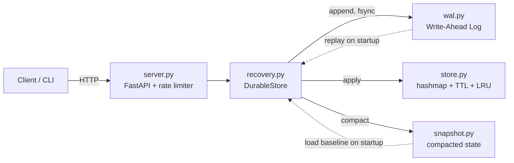

# Persistent Key-Value Store

> **Status: single node today, Raft replication in progress** (work happens on the `raft` branch; the single-node release is tagged `v1-single-node`). This README does not claim "distributed" until a 3-process failover test passes.

[](https://github.com/geethika-sandireddy/distributed-kv-store/actions/workflows/ci.yml)
[](LICENSE)

A from-scratch persistent key-value store with crash recovery and rate
limiting. No Redis, no external database libraries - the storage engine,
durability layer, and eviction policy are all hand-built.

## Why

Most CRUD projects call a database and stop thinking. This one *is* the
database: an in-memory hash map, a write-ahead log for durability, replay-based
crash recovery, LRU eviction under a size cap, WAL compaction, and a
token-bucket rate limiter in front of it - the pieces you'd otherwise get for
free from Postgres or Redis, built and tested individually.

Single-node, on purpose - see the note at the bottom of this section.

## Architecture



```
kvstore/
  store.py        # thread-safe hashmap + TTL + LRU eviction
  ttl.py           # lazy expiry (checked on read, not a background thread)
  lru.py           # doubly linked list LRU tracker, O(1) touch/evict
  wal.py           # write-ahead log: length-prefixed, checksummed records
  snapshot.py      # compaction: snapshot + atomic WAL truncation
  recovery.py      # DurableStore: WAL + Store + compaction, crash recovery
  server.py        # FastAPI HTTP layer (thin - logic lives above)
  rate_limiter.py  # token bucket, per-client
  cli.py           # command-line client over the HTTP API
tests/
  test_store.py / test_ttl.py / test_lru.py / test_store_lru.py
  test_store_concurrency.py / test_recovery_concurrency.py
  test_wal.py           # includes torn-write / corruption / concurrency cases
  test_recovery.py      # failure-injection: crash at each stage of a write
  test_snapshot.py / test_store_snapshot_entries.py / test_compaction.py
  test_server.py / test_cli.py / test_rate_limiter.py
benchmarks/
  benchmark.py     # throughput + p50/p95/p99 latency at varying concurrency
Dockerfile
pyproject.toml     # packaging + ruff/mypy config
.github/workflows/ci.yml
```

**On single-node scope:** a distributed mode (replication, consensus, cluster
membership) was deliberately left out. That's a substantially different,
much harder problem, and a partial/shaky implementation would be a weaker
claim than a genuinely solid single-node store - see `CONTRIBUTING.md`.

## Durability model

Every write goes: **WAL.append() (fsync-blocking) → apply to memory → return
to caller.** A write is durable the instant `append()` returns - before the
in-memory store is touched. On restart, `DurableStore` replays the WAL from
scratch, so memory always converges to what the log says, regardless of
exactly when a previous process crashed relative to its in-memory apply.

The WAL record format is `[4-byte length][4-byte CRC32][JSON payload]`
rather than newline-delimited JSON, specifically so replay can detect a
torn write (the process died mid-`write()`) deterministically: if the file
doesn't have the promised number of bytes, or the checksum doesn't match,
that's the tail of a crash, and replay stops there rather than guessing.
Everything before the tear is kept.

`tests/test_recovery.py` simulates this directly: crash before the WAL
record lands, crash after it's fsynced but before the in-memory apply, and
a truncated final record - each verified to leave exactly the state the
durability contract promises.

## Compaction

The WAL grows forever by default - every SET/DELETE ever issued stays in
the log, even overwritten or deleted keys. `DurableStore.compact()` (or
`POST /admin/compact`, or `kvstore-cli compact`) snapshots current live
state to a separate file, then truncates the WAL to empty. On the next
startup, replay loads the snapshot as a baseline first, then replays only
the WAL records written since the last compaction - bounding replay time
to current dataset size rather than full operation history.

The snapshot write uses the same atomic temp-file-then-`os.replace()`
pattern as the WAL's torn-write handling, so a crash mid-compaction leaves
either the fully-old or fully-new state, never a corrupted half-write.
Compaction isn't triggered automatically yet - see `tests/test_compaction.py`
for the failure-mode coverage, and consider calling it periodically or at
a size threshold in your own deployment.

## Running it

```bash
pip install -r requirements.txt
uvicorn kvstore.server:app --reload
```

Env vars: `KVSTORE_WAL_PATH` (default `data/kvstore.wal`), `KVSTORE_MAX_SIZE`
(unset = no eviction cap).

```bash
curl -X PUT localhost:8000/keys/foo -d '{"value": "bar", "ttl_seconds": 60}'
curl localhost:8000/keys/foo
curl -X DELETE localhost:8000/keys/foo
curl -X POST localhost:8000/keys:batch -d '{"items": {"a": 1, "b": 2}}'
curl -X POST localhost:8000/admin/compact
curl localhost:8000/status
curl localhost:8000/health
```

Or with the included CLI:

```bash
python -m kvstore.cli set foo bar --ttl 60
python -m kvstore.cli get foo
python -m kvstore.cli delete foo
python -m kvstore.cli status
python -m kvstore.cli health
python -m kvstore.cli compact
```

### Docker

```bash
docker build -t kvstore .
docker run -p 8000:8000 -v kvstore-data:/data kvstore
```

## Tests

```bash
pytest tests/ -v
```

## Benchmarks

```bash
python benchmarks/benchmark.py
```

Re-run on a cloud sandbox VM (Intel Xeon @ 2.80GHz, 1 vCPU, Ubuntu 24.04,
ext4 on a virtual disk, fsync on every write, 200 set+get pairs per client).
The numbers previously in this table came from an unnamed environment and
were higher; the sandbox has a single slow vCPU, so treat both sets as
machine-specific and rerun on your own hardware before quoting them.

| Concurrency | Throughput (ops/sec) | p50 (ms) | p95 (ms) | p99 (ms) |
|---|---|---|---|---|
| 1   | 9,757 | 0.188 | 0.278 | 0.331 |
| 10  | 8,226 | 2.283 | 4.384 | 5.380 |
| 50  | 7,464 | 12.856 | 26.475 | 30.966 |
| 100 | 7,165 | 26.459 | 55.611 | 65.559 |

Throughput plateaus past 1 concurrent client on this VM - the
fsync-per-write durability guarantee is the bottleneck, as expected for a
WAL that calls `os.fsync()` on every append rather than batching. Numbers
will vary by disk/hardware; rerun the script to get numbers for your own
machine before quoting them anywhere.

## Known limitations

- No automatic compaction trigger - `compact()` must be called manually
  (or scheduled) rather than firing at a size threshold on its own.
- Batch-set (`/keys:batch`) saves HTTP round-trips but still fsyncs once
  per key internally, not once per batch - no batched-fsync fast path yet.
- Single-node only - see the Architecture section above.

## Contributing

See [CONTRIBUTING.md](CONTRIBUTING.md).

## License

[MIT](LICENSE)

