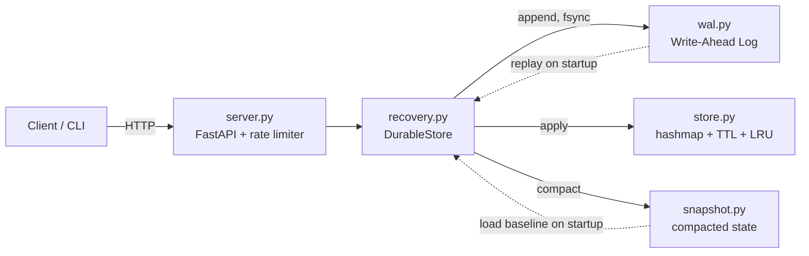
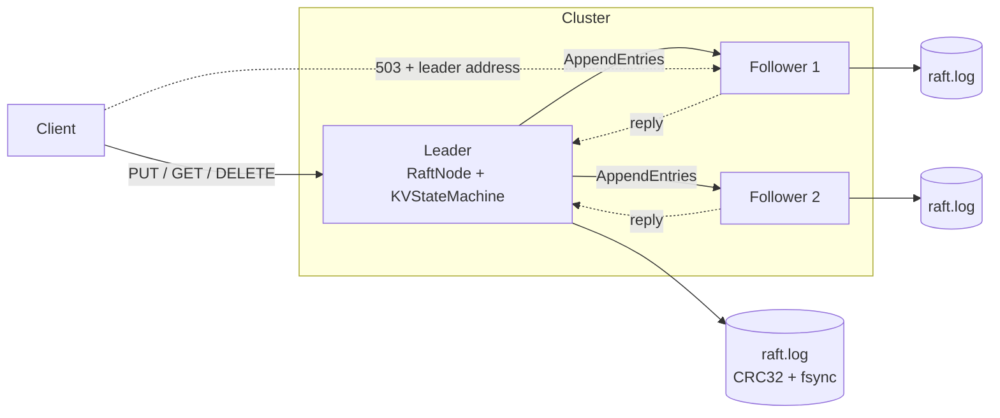

# Persistent Key-Value Store

> **Status: replicated with Raft** (3-process failover and linearizability tests pass). Standalone single-node mode is still available. Release `v1-single-node` is the pre-Raft version.

[](https://github.com/geethika-sandireddy/distributed-kv-store/actions/workflows/ci.yml)
[](LICENSE)

A from-scratch persistent key-value store with crash recovery and rate
limiting. No Redis, no external database libraries - the storage engine,
durability layer, and eviction policy are all hand-built.

## Why

Most CRUD projects call a database and stop thinking. This one *is* the
database: an in-memory hash map, a write-ahead log for durability, replay-based
crash recovery, LRU eviction under a size cap, WAL compaction, and a
token-bucket rate limiter in front of it - the pieces you'd otherwise get for
free from Postgres or Redis, built and tested individually.

Single-node, on purpose - see the note at the bottom of this section.

## Architecture



```
kvstore/
  store.py        # thread-safe hashmap + TTL + LRU eviction
  ttl.py           # lazy expiry (checked on read, not a background thread)
  lru.py           # doubly linked list LRU tracker, O(1) touch/evict
  wal.py           # write-ahead log: length-prefixed, checksummed records
  snapshot.py      # compaction: snapshot + atomic WAL truncation
  recovery.py      # DurableStore: WAL + Store + compaction, crash recovery
  server.py        # FastAPI HTTP layer (thin - logic lives above)
  rate_limiter.py  # token bucket, per-client
  raft/            # storage, node (pure state machine), sim (deterministic cluster), statemachine,
                   # server (HTTP), linearizability checker, localcluster (real processes)
  cli.py           # command-line client over the HTTP API
tests/
  test_store.py / test_ttl.py / test_lru.py / test_store_lru.py
  test_store_concurrency.py / test_recovery_concurrency.py
  test_wal.py           # includes torn-write / corruption / concurrency cases
  test_recovery.py      # failure-injection: crash at each stage of a write
  test_snapshot.py / test_store_snapshot_entries.py / test_compaction.py
  test_server.py / test_cli.py / test_rate_limiter.py
  test_raft_*.py        # rules, simulator + 200-seed fault injection, mutation check, 3-process failover, linearizability
benchmarks/
  benchmark.py     # throughput + p50/p95/p99 latency at varying concurrency
  raft_benchmark.py # commit latency and throughput, 1 node vs 3 nodes
scripts/           # demo.py (kill the leader), demo_docker.sh
docker-compose.yml # 3-node cluster
Dockerfile
pyproject.toml     # packaging + ruff/mypy config
.github/workflows/ci.yml
```

**Scope:** standalone mode is single-node; see *Distributed mode: Raft replication* below for the replicated cluster.

## Distributed mode: Raft replication

The store can run as a 3-node (or 5-node) cluster that replicates every write with the
[Raft](https://raft.github.io/raft.pdf) consensus algorithm, written from scratch in
`kvstore/raft/`. Standalone single-node mode is unchanged (`kvstore/server.py`, WAL, snapshots, LRU, TTL).
In cluster mode the Raft log replaces the WAL and the store is rebuilt by applying committed entries.



A write is acknowledged only after a majority has fsynced it to its log and the leader has
applied it. Followers answer client requests with `503` and the leader's address.

### Try it

```bash
python scripts/demo.py                 # 3 real processes: write, SIGKILL the leader, read everything back
docker compose up --build              # 3 nodes on localhost:8001-8003 (compose file not tested in CI)
```

Environment per node: `NODE_ID`, `PEERS="1=http://host:port,2=...,3=..."`, `DATA_DIR`
(optional `KVSTORE_FSYNC`, `RAFT_ELECTION_MIN/MAX`, `RAFT_HEARTBEAT`). Send `X-Client-ID` and `X-Seq`
headers to make retries idempotent.

### What is guaranteed, and what proves it

| Guarantee | Evidence in the repo |
|---|---|
| At most one leader per term | checked after every simulated step in all fault-injection runs |
| Committed entries never change; applied histories are prefixes of each other; log matching | same per-step invariant checks |
| No acknowledged write is lost across leader failure | simulator failover test, and a real 3-process test that SIGKILLs the leader |
| A minority partition cannot commit; logs converge after healing | `test_minority_partition_cannot_commit_and_logs_converge_after_heal` |
| Operations are linearizable | `tests/test_raft_linearizable_cluster.py`: 3 concurrent clients on 3 real processes, leader SIGKILLed mid-run, history checked with a Wing-Gong style checker (`kvstore/raft/linearizability.py`; the checker itself has tests that reject stale and impossible reads) |
| A retried command applies once | `(client_id, seq)` session table; unit, cluster and HTTP tests |
| Replicas do not diverge because of time | the leader stamps absolute expiry; GET is evaluated at the leader's timestamp; no replica reads its own clock |
| A torn last record is survivable | CRC32 framing; torn tail is dropped on open; cluster still converges |
| The tests can actually fail | mutation check: forcing "majority" to 1 makes the minority-commit scenario and the fault-injection runs fail |

Fault injection runs 200 seeds (random drops, duplicates, reordering, partitions, crashes and
restarts). In my run that was 16,627 acknowledged writes and a median of 9 election terms per
seed. The failing seed is printed so it can be replayed:
`python -c "from tests.test_raft_cluster import run_fuzz_seed; run_fuzz_seed(SEED)"`.

### Raft paper, Figure 2, and where each rule lives

| Rule (Figure 2) | Implementation |
|---|---|
| Persistent state: currentTerm, votedFor, log[] | `FileStorage.save_state / append / truncate_from`; loaded in `RaftNode.__init__`; saved before any reply is built |
| Volatile state: commitIndex, lastApplied; leader nextIndex, matchIndex | `RaftNode.commit_index / last_applied`; `_become_leader`, `_on_append_reply` |
| RequestVote receiver: reject older term; grant if not voted and candidate log up to date | `_on_request_vote`, `_log_up_to_date` |
| AppendEntries receiver: reject older term; reject on prevLogIndex/Term mismatch; delete conflicting entries and all after; append new; commitIndex = min(leaderCommit, last new entry) | `_on_append` |
| All servers: apply committed entries in order; higher term means step down | `_apply_committed`, `_step_down` |
| Followers: election timeout becomes candidate | `tick`, `_start_election` |
| Candidates: new term, vote for self, reset timer, request votes; majority becomes leader | `_start_election`, `_on_vote_reply`, `_become_leader` |
| Leaders: heartbeats; append client commands; send from nextIndex; back up on failure | `tick`, `_broadcast_append`, `propose`, `_send_append`, `_on_append_reply` |
| Leaders: commit N only if a majority holds it and log[N].term == currentTerm (Figure 8) | `_advance_commit`; a new leader appends a no-op in `_become_leader` |

`RaftNode` is a pure state machine: no clock, sockets or threads inside. Time, randomness and the
network are injected, which is what makes the simulator (`kvstore/raft/sim.py`) deterministic.

### Cluster benchmark

`python benchmarks/raft_benchmark.py` starts real processes with fsync on and writes
`results/raft_bench.json` (numbers plus machine info). Run on the same 1-vCPU cloud sandbox as above
(Intel Xeon @ 2.10GHz, Linux, Python 3.12): 200 sequential writes for latency, 8 concurrent clients for throughput.

| Nodes | p50 (ms) | p95 (ms) | p99 (ms) | Throughput (ops/s) |
|---|---|---|---|---|
| 1 | 1.13 | 1.47 | 1.87 | 424.4 |
| 3 | 7.38 | 9.41 | 10.14 | 215.9 |

These numbers are noisy: an earlier run on the same VM gave a 3-node p50 of 4.44 ms (p95 8.57, p99 9.30,
240.2 ops/s) and a 1-node p50 of 1.11 ms. All three nodes share a single vCPU here, so the 3-node figures are
pessimistic and the spread is wide. They are not a statement about real multi-machine deployments.
Rerun on your own hardware before quoting.

### Limitations (honest list)

- No cluster membership changes (the node set is fixed at startup).
- No Raft log compaction or snapshots: the log grows forever and a restart replays all of it.
- No authentication or TLS between nodes or for clients.
- Reads go through the log (simple and linearizable, but slow).
- No pre-vote or leader lease check: a partitioned old leader keeps believing it leads until it hears a higher term. It cannot commit anything, so safety holds, but clients talking to it time out.
- The client session table is never expired.
- Simulation tests use in-memory storage; only the torn-write test and the real-process tests use the on-disk log.
- Linearizability was checked on short histories (3 clients, 2 keys, 1 leader kill), not exhaustively.
- Not tested on Windows. The compose file and `scripts/demo_docker.sh` have not been run in CI.

## Durability model (single-node WAL)

Every write goes: **WAL.append() (fsync-blocking) → apply to memory → return
to caller.** A write is durable the instant `append()` returns - before the
in-memory store is touched. On restart, `DurableStore` replays the WAL from
scratch, so memory always converges to what the log says, regardless of
exactly when a previous process crashed relative to its in-memory apply.

The WAL record format is `[4-byte length][4-byte CRC32][JSON payload]`
rather than newline-delimited JSON, specifically so replay can detect a
torn write (the process died mid-`write()`) deterministically: if the file
doesn't have the promised number of bytes, or the checksum doesn't match,
that's the tail of a crash, and replay stops there rather than guessing.
Everything before the tear is kept.

`tests/test_recovery.py` simulates this directly: crash before the WAL
record lands, crash after it's fsynced but before the in-memory apply, and
a truncated final record - each verified to leave exactly the state the
durability contract promises.

## Compaction

The WAL grows forever by default - every SET/DELETE ever issued stays in
the log, even overwritten or deleted keys. `DurableStore.compact()` (or
`POST /admin/compact`, or `kvstore-cli compact`) snapshots current live
state to a separate file, then truncates the WAL to empty. On the next
startup, replay loads the snapshot as a baseline first, then replays only
the WAL records written since the last compaction - bounding replay time
to current dataset size rather than full operation history.

The snapshot write uses the same atomic temp-file-then-`os.replace()`
pattern as the WAL's torn-write handling, so a crash mid-compaction leaves
either the fully-old or fully-new state, never a corrupted half-write.
Compaction isn't triggered automatically yet - see `tests/test_compaction.py`
for the failure-mode coverage, and consider calling it periodically or at
a size threshold in your own deployment.

## Running it

```bash
pip install -r requirements.txt
uvicorn kvstore.server:app --reload
```

Env vars: `KVSTORE_WAL_PATH` (default `data/kvstore.wal`), `KVSTORE_MAX_SIZE`
(unset = no eviction cap).

```bash
curl -X PUT localhost:8000/keys/foo -d '{"value": "bar", "ttl_seconds": 60}'
curl localhost:8000/keys/foo
curl -X DELETE localhost:8000/keys/foo
curl -X POST localhost:8000/keys:batch -d '{"items": {"a": 1, "b": 2}}'
curl -X POST localhost:8000/admin/compact
curl localhost:8000/status
curl localhost:8000/health
```

Or with the included CLI:

```bash
python -m kvstore.cli set foo bar --ttl 60
python -m kvstore.cli get foo
python -m kvstore.cli delete foo
python -m kvstore.cli status
python -m kvstore.cli health
python -m kvstore.cli compact
```

### Docker

```bash
docker build -t kvstore .
docker run -p 8000:8000 -v kvstore-data:/data kvstore
```

## Tests

```bash
pytest tests/ -v   # 165 tests, about 20 seconds here (the original 107 still pass)
```

## Benchmarks

```bash
python benchmarks/benchmark.py
```

Re-run on a cloud sandbox VM (Intel Xeon @ 2.10GHz, 1 vCPU, Linux, Python 3.12, fsync on every
write, 200 set+get pairs per client). The same VM produced the Raft numbers below. Figures like these
vary from run to run and machine to machine, so treat them as indicative and rerun on your own
hardware before quoting them.

| Concurrency | Throughput (ops/sec) | p50 (ms) | p95 (ms) | p99 (ms) |
|---|---|---|---|---|
| 1   | 11,223 | 0.154 | 0.274 | 0.413 |
| 10  | 10,244 | 1.884 | 3.731 | 4.290 |
| 50  | 12,155 | 7.296 | 16.355 | 22.734 |
| 100 | 11,568 | 16.343 | 32.365 | 40.769 |

Throughput is roughly flat across concurrency levels on this single-vCPU VM - the
fsync-per-write durability guarantee is the bottleneck, as expected for a
WAL that calls `os.fsync()` on every append rather than batching. Numbers
will vary by disk/hardware; rerun the script to get numbers for your own
machine before quoting them anywhere.

## Known limitations

- No automatic compaction trigger - `compact()` must be called manually
  (or scheduled) rather than firing at a size threshold on its own.
- Batch-set (`/keys:batch`) saves HTTP round-trips but still fsyncs once
  per key internally, not once per batch - no batched-fsync fast path yet.
- Standalone mode is single-node; for replication use the Raft cluster mode (see its limitations above).

## Contributing

See [CONTRIBUTING.md](CONTRIBUTING.md).

## License

[MIT](LICENSE)

